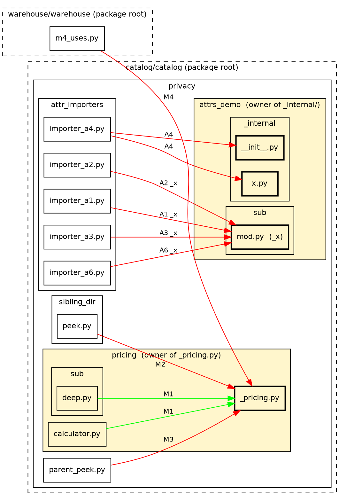
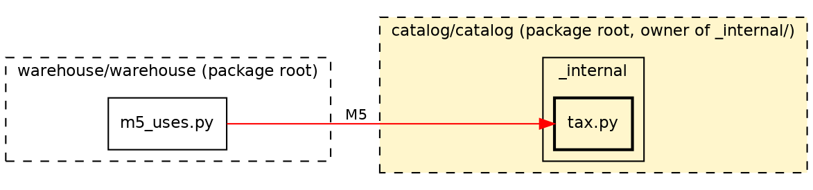
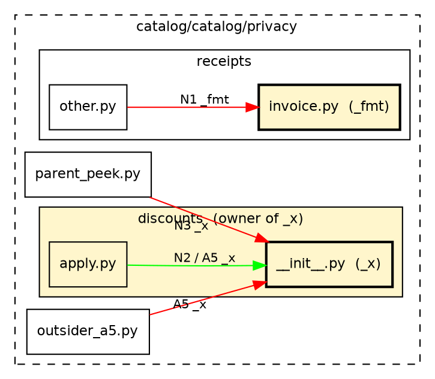
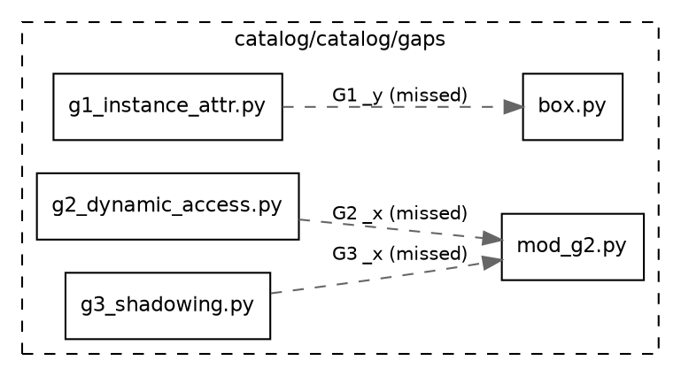
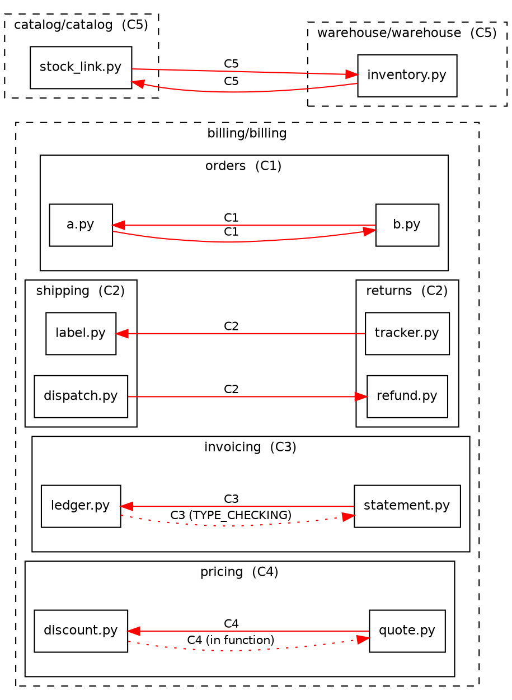

# `tests/showcase/`

A small static monorepo of committed code, not generated at test time.
It demonstrates every rule `pymodularity check` enforces and its documented blind spots.

- browsing: a reader can browse it case by case.
- golden test: `tests/test_showcase.py` runs `check --no-deps` on it and diffs stdout and stderr against `expected_check.txt` and `expected_stderr.txt`.

3 package roots stand in for 3 services of a toy bookstore: `catalog/`,
`billing/`, `warehouse/`. Every case's code carries a `# <ID>` comment at
its first line (or inline on the triggering statement).

## Case groups

- **C, cycles:** files or directories that import each other in a loop.
- **M, private modules:** a `_`-prefixed module or directory imported from outside its owner.
- **N, private names:** a `_`-prefixed name imported from outside its owner.
- **A, attribute access:** a private module or name reached as `mod._x` instead of imported.
- **S, structure:** a file over the line limit, a directory over the entry limit, or a module over the public-name limit.
- **G, gaps:** the documented blind spots, plus 2 import-resolution edge cases (G5, G6).

## Diagrams

Legend:

- **Box with a title:** a directory, nested as in the real tree.
- **Dashed box:** a package root.
- **Box without a title:** a file.
- **Bold border:** the private target.
- **Title "owner of ...":** the owner of the private item.
  - private module or `__init__.py` name: the owner is a directory.
  - private name in a regular file: the owner is that file.
- **Yellow area:** code inside it may use the private item. An edge from outside is a finding.
- **Green edge:** an allowed import.
- **Red edge:** a finding.
- **Red dotted edge:** a finding through a special import kind, either `TYPE_CHECKING`-only or in-function.
- **Grey dashed edge:** a missed import, i.e. a documented gap.
- **Edge label:** the case ID, plus the private name for name cases.
- **S cases:** no diagram, because they have no edge to draw.

Re-render with `dot -Tpng -Gdpi=150 <name>.dot -o <name>.png` from this directory.

Module/attribute privacy (M1-M4, A1-A4, A6):

Private directory directly below a package root (M5):

Name privacy (N1-N3, A5):

Gaps that draw an edge (G1, G2, G3):

Import cycles (C1-C5):

| ID | File(s) | Expected | Why |
|----|---------|----------|-----|
| C1 | `billing/billing/orders/{a,b}.py` | finding | 2 files import each other directly. |
| C2 | `billing/billing/{shipping,returns}/*.py` | finding (directory level only) | `shipping/dispatch.py` and `returns/tracker.py` each import a *different* file in the other directory, so the 2 directories form an SCC in their parent's view, but no single file sits in a loop — no file-level cycle. |
| C3 | `billing/billing/invoicing/{statement,ledger}.py` | finding | `ledger.py` imports `statement.py` back only under `if TYPE_CHECKING:`; still counted. |
| C4 | `billing/billing/pricing/{quote,discount}.py` | finding | `discount.py` imports `quote.py` back only inside a function body; still counted. |
| C5 | `catalog/catalog/stock_link.py`, `warehouse/warehouse/inventory.py` | finding | a cycle across 2 package roots; the cycle ban is repo-wide, not per package. |
| M1 | `catalog/catalog/privacy/pricing/{calculator.py,sub/deep.py}` | allowed | both import `_pricing.py` from its own directory or a descendant of it. |
| M2 | `catalog/catalog/privacy/sibling_dir/peek.py` | finding | imports `_pricing.py` from a sibling directory of its owner. |
| M3 | `catalog/catalog/privacy/parent_peek.py` | finding | imports `_pricing.py` from `pricing/`'s parent directory. |
| M4 | `warehouse/warehouse/m4_uses.py` | finding | imports `_pricing.py` from another package root entirely. |
| M5 | `warehouse/warehouse/m5_uses.py` | finding | `catalog/catalog/_internal/` sits directly under the `catalog` package root, so its scope is the whole package; only a different root reaching in is a finding (an importer elsewhere inside `catalog` would be allowed). |
| N1 | `catalog/catalog/privacy/receipts/{invoice,other}.py` | finding | `_fmt` is private to `invoice.py` alone (a single-file owner); even a sibling in the same directory may not import it. |
| N2 | `catalog/catalog/privacy/discounts/apply.py` | allowed | imports `_x` from `discounts/__init__.py` while living under `discounts/`. |
| N3 | `catalog/catalog/privacy/parent_peek.py` | finding | imports the same `_x` from outside `discounts/`. |
| A1 | `catalog/catalog/privacy/attr_importers/importer_a1.py` | finding | `import a.b.mod` then `a.b.mod._x`. |
| A2 | `.../importer_a2.py` | finding | `import a.b.mod as m` then `m._x`. |
| A3 | `.../importer_a3.py` | finding | `from a.b import mod` then `mod._x`. |
| A4 | `.../importer_a4.py` | finding (2 findings, same case) | `import a as ad` then `ad._internal.x.f()`: the attribute chain visits both the private package `_internal` and its submodule `x`, each reported once. |
| A5 | `catalog/catalog/privacy/discounts/apply.py` (allowed), `catalog/catalog/privacy/outsider_a5.py` (finding) | both | `pkg._x` with `_x` from `__init__.py`: allowed under the owning directory, a finding from outside it. |
| A6 | `.../importer_a6.py` | finding (exactly 1) | `from a.b.mod import _x` plus `a.b.mod._x` in the same file; the attribute-form hit on the same (importer, target, name) is deduplicated against the import-form one. |
| S1 | `catalog/catalog/structure/big_file.py` | finding | 501 physical lines, 1 over the 500-line limit. |
| S2 | `catalog/catalog/structure/wide_dir/` (finding, 11 entries), `.../wide_dir_ok/` (allowed, 10 entries + `__init__.py` + `__main__.py`) | both | the fan-out limit is 10; the structural files don't count as entries. |
| S3 | `catalog/catalog/structure/wide_names.py` (finding, 16 public names), `.../wide_names_ok.py` (allowed, 16 names but 1 decorator-registered) | both | the public-name limit is 15; a decorated top-level function doesn't count. |
| G1 | `catalog/catalog/gaps/{box,g1_instance_attr}.py` | missed | `obj._y` on an instance needs type information this tool doesn't have. |
| G2 | `catalog/catalog/gaps/g2_dynamic_access.py` | missed | `getattr(mod, "_x")` and `importlib.import_module("...")` bypass the static import graph entirely. |
| G3 | `catalog/catalog/gaps/g3_shadowing.py` | missed | a parameter named `mod` anywhere in the file drops the import's binding, so a real module-level `mod._x` is missed. |
| G4 | `catalog/catalog/gaps/g4_third_party.py` | missed | no repo file or folder is named `numpy`, so the import never resolves inside the repo and the later `numpy._x` escapes detection. |
| G5 | `catalog/catalog/gaps/collide/{requests/_queue.py,client_g5.py}` | resolved correctly (no edge) | a local folder happens to be named `requests`, like the third-party library, but `requests` in `client_g5.py` resolves only through import roots (the repo root, package roots, their `src/`); the local `collide/requests` folder isn't one, so the import is correctly treated as the real, unresolved third-party library. No edge, no finding. |
| G6 | `billing/g6app/main.py`, `catalog/g6app/main.py`, `scripts/g6_caller.py` | no edge, warning only | `billing/` and `catalog/` are 2 different package roots that each happen to provide a top-level `g6app.main` module; `scripts/g6_caller.py` sits under neither root, so no ancestor root wins and `import g6app.main` is genuinely ambiguous. The tool warns and draws no edge; Python itself would import whichever root came first on `sys.path`. |
| G7 | `billing/billing/g7/{producer,consumer}.py` | missed (no edge) | the 2 files are coupled only through a string registry key / env var, never an import. |
| G8 | `catalog/catalog/gaps/tests/breaks_privacy_g8.py` | skipped | sits inside a directory literally named `tests`, which the tool (and pytest, since the file isn't named `test_*.py`/`*_test.py`) always skips. |

Rule definitions: [docs/rules.md](../../docs/rules.md).
